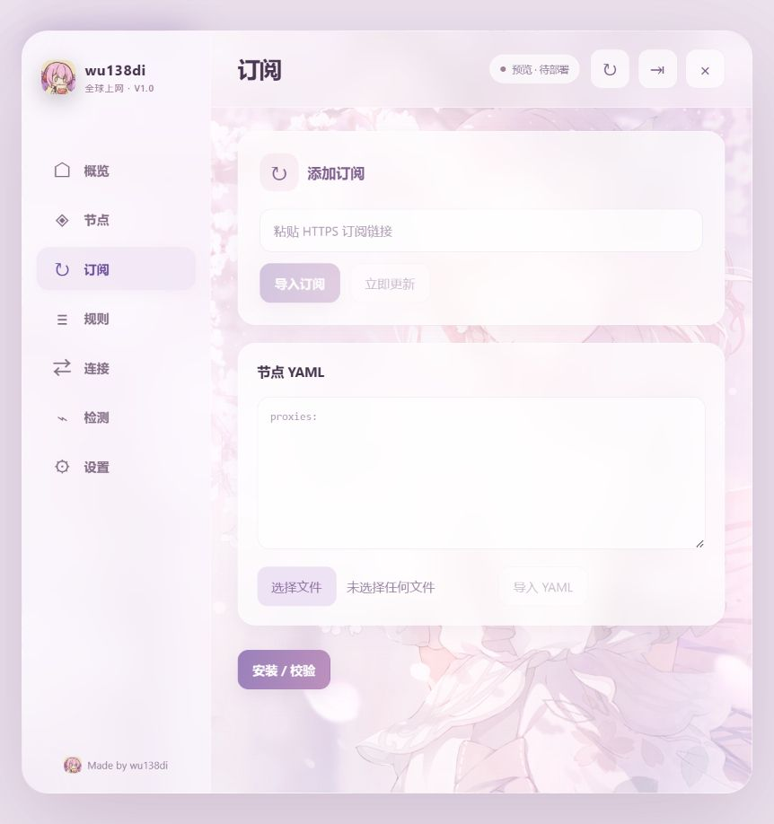

# wu138di 全球上网 V1.0

面向 **UFI-TOOLS 完整版**的 Mihomo 网关管理插件。支持订阅、节点 YAML、规则查看、连接管理、测速与网络检测。



## 下载与安装

- [TXT 插件](dist/wu138di-全球上网-V1.0.txt)
- [JS 插件](dist/wu138di-全球上网-V1.0.js)
- [离线界面预览](dist/界面预览.html)：下载后在本地打开，不连接设备、不生成示例节点。

TXT / JS 二选一，在 UFI-TOOLS 的插件功能中导入。升级前移除旧的同类界面插件，保留设备上的 Mihomo 服务、配置与订阅。

初始入口口令为 **2007**。登录后可在「设置 → 登录口令」修改；修改后使用新口令，登录页不再展示默认提示。口令以随机盐 PBKDF2-SHA256 摘要保存在设备 root 保护目录，不保存明文或浏览器本地存储。

本仓库没有内置个人订阅、节点凭据、设备 API 密钥或自定义口令。界面口令不替代 UFI 登录、Root 权限与 Mihomo 控制器认证。

## 功能

- 概览、节点、订阅、规则、连接、检测、设置。
- HTTPS 订阅和 YAML 文件/文本导入；YAML 需包含标准 `proxies:` 节点段。
- 导入只更新节点，不覆盖网关 DNS、端口、规则与运行模式；先校验、再提交，失败恢复原数据。
- 本地 YAML 模式暂停定时订阅刷新，重新导入链接后恢复订阅模式。
- 使用节点所属 provider 的健康检查接口；测速和设备命令串行，显示核心返回的测量值。过期历史值不当作当前延迟。
- 开启前检测节点与本机代理 HTTPS 链路；节点不可用时不接管终端流量。
- 网络检测区分路由、DNS、国内直连、代理连接；订阅 HTTP 401/403 单独显示。
- 内置 SVG 国旗与独立选中标记，无外部旗标 CDN。
- 樱花背景、玻璃卡片、手机底栏、桌面侧栏、系统深浅色跟随和 44px 触控区域。

安装界面不代表开启代理；使用电源按钮手动开启/停止，开机自启独立控制。关闭网页不等于停止设备代理。

## 适用范围

当前仅在 **U30 Pro / MU5358 / B24** 环境实测。安装器依赖 Android ARM64、Root、Magisk BusyBox、系统 curl、`br0`、`sipa_eth0`、`192.168.0.1/24` 及相应透明代理内核能力。

不宣称 F50、CPE 或所有支持 UFI-TOOLS 的设备通用。其他型号需适配机型检查、网卡、网段和网络恢复逻辑。

节点测速、订阅可用性与平台播放权限是不同事项；延迟数值随节点和网络变化，不承诺所有节点低于某个固定数值。

## 源码构建与测试

需要 Python 3.10+、Node.js 20+ 和 npm。

```sh
npm ci
npm test
python scripts/build.py
```

`dist/` 为可直接导入的独立文件；运行时不依赖 npm、Python、外部 JS CDN。测试使用合成数据，不访问用户设备。

## 参考与第三方内容

- [UFI-TOOLS](https://github.com/kanoqwq/UFI-TOOLS)
- [Mihomo](https://github.com/MetaCubeX/mihomo) / [API 文档](https://wiki.metacubex.one/api/)
- [U30 Pro 部署方案记录](https://github.com/ez842/zhongxing-u30-pro-mihomo-proxy)
- CryptoJS 4.2.0：MIT，许可见 [src/vendor/LICENSE](src/vendor/LICENSE)。用于 HTTP 局域网页面的密码派生兼容。

本仓库不是 UFI-TOOLS、Mihomo 或 Clash Verge 官方发行版。界面布局参考 Clash Verge，未包含其桌面程序。图片素材由使用者提供；代码许可不自动涵盖图片素材的第三方权利。

**Made by wu138di**
